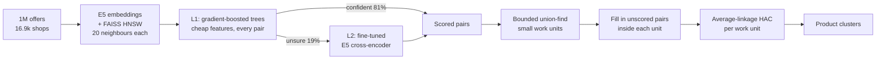

# Cross-store product clustering

A small-scale, from-scratch replication of Shopify Engineering's
[Catalog Clustering, Part II](https://shopify.engineering/catalog-clustering-part-ii):
finding listings of the **same real-world product** across thousands of independent shops.
It runs locally on 1M real product offers from the WDC Product Corpus.

**Results on 222k held-out offers:**

- **3× fewer false merges than connected components at the same recall:**
  pair precision is 0.847 for connected components and **0.944** for this pipeline, both at recall 0.63.
- Against connected components at its 0.5 threshold (chosen on val), **80% fewer wrong pairs** (178,694 → 36,405).
- On WDC's 4,398 hand-labeled hard pairs, the fine-tuned cross-encoder achieves an **F1 score of 0.81**.
  Embedding cosine similarity reaches 0.56.
- The cross-encoder only scores the 19% of pairs the cheap model is unsure about.
  The whole pipeline runs in about 75 minutes on a MacBook Pro.

## The problem

Ten shops sell the same hard drive under ten different titles.
To search or compare across shops, you need to know they are the same product, often without a reliable barcode or universal identifier.

"Same product" is decided one pair at a time, but those decisions aren't transitive.
If A matches B and B matches C, A might still be a different product from C.
Linking every matched pair (connected components) chains look-alike products into one cluster.
In this data, it put **21 different Lexmark cartridges** in one 180-offer cluster.

## Pipeline

Three stages: **retrieve** candidate pairs, **score** them, then **cluster** the scored pairs.



| Stage | Shopify (per the article) | This project |
|---|---|---|
| Candidates | Approximate nearest neighbour (ANN) search over embeddings | `multilingual-e5-small` title embeddings + FAISS HNSW, 20 neighbours per offer |
| L1 | Gradient-boosted trees (GBDT) on cheap features, every pair | scikit-learn `HistGradientBoostingClassifier` on 9 features (cosine, word overlap, fuzzy match, model-number match, brand, shop, category…) |
| L2 | Fine-tuned multilingual E5 cross-encoder on uncertain pairs | Fine-tuned `multilingual-e5-small` cross-encoder (400k pairs, 1 epoch). It re-scores pairs where L1 is between 0.05 and 0.95 |
| L3 | Image + metadata reranker | Not built: the dataset is text only |
| Labels | LLM judge, checked against human labels | WDC product groups from shared GTIN/MPN codes, checked on WDC's 4.4k human-labeled pairs |
| Work units | Distributed bounded union-find, with a budget on the sum of degrees | Same idea, on one machine |
| Final clusters | HAC per work unit, with a learned GBDT merge rule | Average-linkage HAC per work unit, with a fixed threshold |

**Why two E5 models?**
- Retrieval uses E5 as a **bi-encoder**: one vector per title, so 1M titles can go into an HNSW index.
- L2 uses E5 as a **cross-encoder**: it reads both titles together. That is more accurate, but it needs a pair as input,
  so it can only score pairs that retrieval has already found.

**Why bounded union-find?**
Union-find builds **work units**, rather than the final clusters.
- Edges are added from highest score to lowest.
- Two groups merge only if their combined cost (sum of node degrees) stays under a budget.

That keeps every unit small enough to score all of its pairs and run HAC, no matter how large the graph is.

## Data

[WDC Large-Scale Product Corpus v2](http://webdatacommons.org/largescaleproductcorpus/v2/) (English offers).
Offers are grouped into products by shared identifiers (GTIN/MPN).

**1,010,358 offers from 16,931 shops in 421,504 product groups** were sampled:
- product groups sold by 2+ shops (cross-store matches, up to 50 offers each)
- 200k single offers with no match as distractors (like a real catalog)
- every group in WDC's hand-labeled gold standard, kept whole (the largest has 271 offers)

| Split | Offers | Product groups | Candidate pairs |
|---|---|---|---|
| train | 689,577 | 293,395 | 9,984,581 |
| val | 98,808 | 41,967 | 1,440,365 |
| test | 221,973 | 86,142 | 3,200,219 |

The split is **by product group**, so test products are never seen in training.
Gold-standard groups are always placed in test.
Thresholds and the budget were chosen on val.

## Results

### Clustering (test split)

| Method | Pair precision | Pair recall | Pair F1 | Wrong pairs | B-cubed F1 | Largest cluster |
|---|---|---|---|---|---|---|
| Connected components (score ≥ 0.5) | 0.787 | **0.675** | 0.727 | 178,694 | 0.888 | 269 |
| **Bounded union-find + HAC** | **0.944** | 0.631 | **0.757** | **36,405** | **0.891** | 112 |

- Both methods use the same L1 → L2 pair scores.
- "Wrong pairs" counts pairs of offers put in the same cluster that are different products (false positives).
- B-cubed scores each offer and then averages, so one giant cluster can't dominate the score.

**Is the baseline just set too loose?**
Here is connected components on the same test scores at stricter thresholds:

| Method | Pair precision | Pair recall | Wrong pairs |
|---|---|---|---|
| Connected components ≥ 0.50 | 0.787 | 0.675 | 178,694 |
| Connected components ≥ 0.70 | 0.847 | 0.632 | 111,037 |
| Connected components ≥ 0.80 | 0.884 | 0.606 | 77,323 |
| Connected components ≥ 0.90 | 0.912 | 0.577 | 54,497 |
| Connected components ≥ 0.95 | 0.918 | 0.553 | 47,907 |
| Connected components ≥ 0.99 | 0.859 | 0.243 | 38,882 |
| **Bounded union-find + HAC** | **0.944** | 0.631 | **36,405** |

- At the **same recall** (0.63), the pipeline makes **3× fewer false merges**.
- Connected components' precision never goes above 0.918, because chaining remains.
  Stricter thresholds lower it again: true products split apart faster than the look-alike errors disappear.
- Even at 0.99, connected components makes more wrong pairs than this pipeline (38,882 vs 36,405) at much lower recall (0.243 vs 0.631).

### Pair scorers on WDC's hand-labeled gold standard

These are 4,398 hard pairs (27% matches) labeled by people.
L1, L2 and the cascade call a pair a match at score ≥ 0.5.

| Scorer | Precision | Recall | F1 |
|---|---|---|---|
| Embedding cosine (threshold 0.88, tuned on this set) | 0.407 | 0.918 | 0.564 |
| L1: gradient-boosted trees | 0.833 | 0.387 | 0.529 |
| **L2: fine-tuned cross-encoder** | 0.928 | **0.720** | **0.811** |
| L1 → L2 cascade (what the pipeline uses) | **0.938** | 0.664 | 0.778 |

## Run it

Download the WDC files (about 4.8 GB) into `data/raw/`:

```bash
mkdir -p data/raw && cd data/raw
curl -O https://data.dws.informatik.uni-mannheim.de/largescaleproductcorpus/data/v2_nonnorm/offers_corpus_english_v2_non_norm.json.gz
curl -O https://data.dws.informatik.uni-mannheim.de/largescaleproductcorpus/data/v2/id_url_mapping.csv.gz
curl -O https://data.dws.informatik.uni-mannheim.de/largescaleproductcorpus/data/v2_nonnorm/goldstandards/all_gs.json.gz
cd ../..
```

Then run each step in order. Times are on a MacBook Pro (M4 Pro, 64 GB), using the Apple GPU for the transformer steps.
NVIDIA GPUs are used automatically when available, otherwise the CPU.

```bash
uv sync
uv run python prepare_data.py             # a few min  -> data/offers.parquet
uv run python embed.py                    # ~10 min    -> data/embeddings.npy
uv run python candidates.py               # ~1 min     -> data/candidates.parquet
uv run python features.py                 # optional: sanity-check the L1 features
uv run python train_l1.py                 # ~5 min     -> models/l1.pkl, data/scored_pairs.parquet
uv run python train_l2.py                 # ~38 min    -> models/l2/
uv run python score_l2.py                 # ~18 min    -> adds L2 scores to data/scored_pairs.parquet
uv run python test_bounded_union_find.py  # tests for the bounded union-find
uv run python cluster.py                  # ~20 s      -> data/predictions_test.parquet
uv run python evaluate.py                 # clustering metrics
uv run python eval_gold.py                # gold-standard pair metrics
```

`torch` and `faiss` are kept in separate scripts.
On macOS, loading both in one Python process can crash with a duplicate OpenMP library error.
